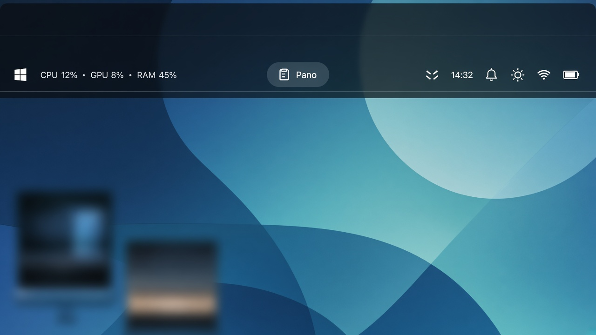
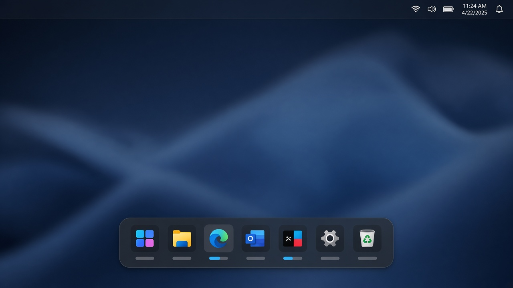
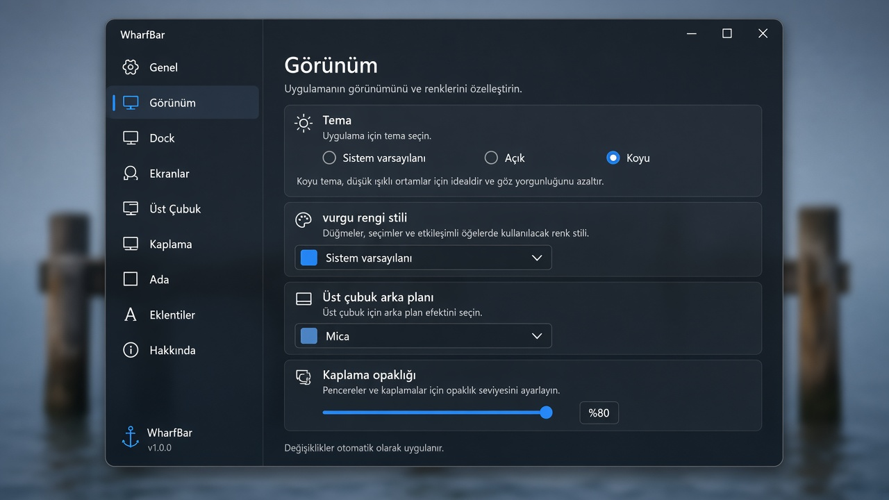

<p align="center">
  
</p>

<h1 align="center">WharfBar</h1>

<p align="center">
  A Fluent top bar and dock for Windows — real AppBar space, pinned and running apps, and a quiet status strip.
</p>

<p align="center">
  
  
  
  
  
</p>

<p align="center">
  <a href="README.tr.md">Türkçe</a>
  ·
  <a href="https://github.com/xkeidm/wharfbar/milestones">Roadmap</a>
  ·
  <a href="CHANGELOG.md">Changelog</a>
</p>

---

## What it is

WharfBar draws its own top bar and dock on the Windows desktop — inspired by Windows, macOS, and Linux shells, rendered in Windows Fluent (no Apple branding or icon language). The app mark is the **Dusk** pier + sun; Settings → Appearance can switch the bar/dock glyph to the Windows logo.

The top bar is a real AppBar (`ABE_TOP`, 30 DIP): maximized windows stop under it. The dock is a topmost overlay. While WharfBar runs, the Windows taskbar is hidden and restored on a normal quit.

Each Windows app keeps its own menu. The top bar carries the clock, status, tray, and controls. When choices conflict: low resource use, then a native Fluent look, then simplicity.

## Download & install

Get the latest beta from **[GitHub Releases](https://github.com/xkeidm/wharfbar/releases)** — every
`1.0.0-beta*` build is published as a prerelease, so `/releases/latest` does not resolve while the beta runs.

| Asset | What to do |
|-------|------------|
| `WharfBar-Setup-<version>-x64.exe` | Run the installer: per-user, no admin/UAC, Start-menu entry, optional desktop shortcut, uninstaller in Settings → Apps |
| `WharfBar-<version>-win-x64-portable.zip` | Extract and run `WharfBar-<version>-win-x64-portable\WharfBar.exe`; nothing is installed |
| `SHA256SUMS.txt` | SHA-256 checksums of both files (`sha256sum` format) — verify before running |

**Requirements:** Windows 10 version 2004 (build 19041) or newer, or Windows 11; x64 only. The download is self-contained (.NET 8 is bundled), so you do not need to install the .NET runtime.

Settings live in `%AppData%\WharfBar\config.json` — not the install folder — and survive upgrades and uninstall. **Start with Windows** is an app setting (Settings → General): the app keeps its own Startup shortcut and the installer does not create one.

The build is unsigned, so SmartScreen may warn ("Windows protected your PC" → **More info** → **Run anyway**). That is a known beta limitation; check the SHA-256 sums before running.

**Quitting:** tray icon → **Quit WharfBar**, Alt+F4 on the bar, or the top-bar logo menu. Scripts, the installer and the uninstaller use `WharfBar.exe --quit` — never force-kill it ([docs/07](docs/07-packaging-and-releases.md)).

## Screenshots

| Top bar | Dock | Settings |
|:-------:|:----:|:--------:|
|  |  |  |

<p align="center"><sub>Illustrative product stills. Live capture here would reserve an AppBar strip, so these mocks stand in until real sessions land.</sub></p>

## Why run it

- Clock, CPU / GPU / RAM, network, battery, notifications, and quick settings on one reserved strip
- Pinned apps (including closed) and running apps share a dock — one tile per app — while the taskbar stays out of the way
- Clipboard history, now playing, and short volume / brightness / battery readouts in the center island
- Wi-Fi, display projection, monitor brightness, and media controls from the bar
- Sparse idle work: one shared window census (~3 s), stats every 4 s off the UI thread, tray mirror every 4 s without recapturing bitmaps every pass

## Features

<details>
<summary><strong>Top bar</strong></summary>

<br>

One bar per enabled monitor, each registered as an AppBar. Visibility is the `monitors` config.

- **Left:** brand logo menu (default WharfBar Dusk mark; optional Windows logo via `logoStyle`) — Windows Settings, profile, lock, sleep, shut down, restart, WharfBar settings, About, quit — plus a one-line `CPU · GPU · RAM` readout. Hover opens a sparkline and network throughput. Multiple GPUs can be listed separately (`topBar.showGpuPerAdapter`). Missing GPU counters are omitted. No temperature.
- **Center:** the island pill.
- **Right:** a status strip you can show, hide, and reorder from the right-click menu or Settings → Top bar. Default order: tray mirror, hidden-icons chevron, clock, notifications, quick settings, network, battery. Volume, brightness, and media start hidden (the island already shows them). Saved order is kept.
- Clock is a single line in the UI language (Settings → General → Language, or follow Windows when set to System). Click opens notification text and a month calendar. The bell sends `Win+N`.
- Background is Mica, transparent, or a tint plus an opacity slider. Mica and `AllowsTransparency` are never combined. On the transparent top bar the text tone follows the wallpaper automatically (light strip → dark text, dark strip → light text) so text stays readable on any wallpaper.

</details>

<details>
<summary><strong>Island</strong></summary>

<br>

On the primary bar the pill idles as **Clipboard**, or shows the last clip when `island.idleLabel` is `lastClip`. It expands for now playing (`island.musicPresence` is `persistent` by default, or `transient`) and briefly for volume, brightness, and battery. A HUD face can add up to two satellites; the now-playing pill itself is just the cover and the track title. Clipboard history and file drops belong to the primary pill. A secondary monitor’s pill shows music and those counters only. The bar stays 30 DIP; the panel opens under the pill.

Low battery uses `island.lowBatteryPercent` (default 20, allowed range 5–50).

The panel under the pill has seven tabs: **Clipboard** (history + search), **Wallpaper** (bundled and your own gallery, with fade / blur transitions), **Music** (now playing, live progress and duration, animated transport; the panel is tinted from the album art), **Shelf** (dropped-file chips: open with the default app, multi-select and drag out, copy path or file, remove one, or empty), **Prompter** (auto-scrolling reading view), **Camera** (mirror preview + on/off + microphone state) and **Color** (recent picks + a macOS-style screen loupe that copies the exact colour under the cursor as HEX). Each body can be hidden in Settings → Island, and a file drop opens the panel on Shelf.

</details>

<details>
<summary><strong>Dock</strong></summary>

<br>

A topmost overlay: bottom-left, bottom-center, bottom-right, or the left edge. It can auto-hide, and it hides while another app is fullscreen.

- **Left:** the Windows taskbar’s `User Pinned\TaskBar` shortcuts, in taskbar order, including apps that are not running, then entries in `dock.items` that are not already there. A running pin stays on that same tile.
- **Right:** running apps that are not pinned, one tile per app (canonical path, AppUserModelID, or process id). Extra windows are a count badge and a **Windows** submenu. A minimized window is not a second tile.
- The glyph stays a fixed size. Default: 24 DIP glyph, 40 DIP button, 4 DIP gap. Hover fills the button and can show a DWM thumbnail of that app’s windows on this monitor. A progress bar appears under the icon when UI Automation reports one. An icon that wants attention gets a short accent pulse.
- Pin and unpin write `dock.items`. A file or folder target also gets a `.lnk` in `User Pinned\TaskBar`. `Taskband` is left untouched.
- Drag to reorder. Drop `.lnk`, `.exe`, `.bat`, or `.cmd` from Explorer. Right-click: title card, pin or unpin, end task, close window, run as administrator, open file location, new window, window list.
- Background is Mica, transparent, or tint, chosen separately from the top bar.
- **Launchpad** (far left), **Downloads**, and **Recycle Bin** (far right) are built-in tiles and are not written into the pin folder. A folder pin opens a stack. Store packages use the package icon when it resolves, and a letter glyph when it does not. Badges, the running mark, and thumbnails count windows on that dock’s monitor.

</details>

<details>
<summary><strong>Taskbar</strong></summary>

<br>

While WharfBar runs, the Windows taskbar is hidden. A normal quit restores the state from before launch. After a force-kill, a watchdog restores the taskbar in about half a second. The reserved top strip is separate; see the warning under [Build and run](#build-and-run).

</details>

<details>
<summary><strong>Quick settings</strong></summary>

<br>

One flyout, opened from the quick-settings, volume, or network icon: **Main**, **Mixer**, and **Network**.

- Wi-Fi: live network list, connect, and disconnect through `wlanapi`. Profiles are stored as plain text. The list is empty while the radio is off. Hidden and enterprise networks are left to Windows Settings.
- Bluetooth: the radio, plus paired classic and LE devices. Connecting a device stays in Windows Settings.
- Night light follows the real setting when it can be written. When it cannot, the tile opens Windows Settings.
- Project: PC screen only, duplicate, extend, or second screen only.
- The energy-saver tile tracks the system switch and toggles it.
- The veil tile toggles the color overlay.

</details>

<details>
<summary><strong>Brightness · Media · Veil</strong></summary>

<br>

**Brightness** — a separate flyout: one master slider for every display, and a card per monitor. Desktop monitors use DDC/CI; internal panels use WMI. Writes go through a background queue with a 50 ms debounce.

**Media** — Windows SMTC. The status-strip media icon appears only while a session exists. The flyout shows cover art, title, artist, play/pause, previous, and next, and a session picker when more than one app is active. The island can keep now playing on the pill.

**Veil** — a click-through full-screen color overlay on the primary monitor. Toggle from quick settings or with the shortcut (`Ctrl+F11` by default). Color, opacity, and the shortcut are on the Veil settings page.

</details>

<details>
<summary><strong>Tray</strong></summary>

<br>

WharfBar’s own notification icon has a quit item, **Quit WharfBar**. On the primary bar, third-party tray icons are mirrored with documented toolbar messages and clicks are forwarded. Chosen icons can sit in a pill behind the chevron; the chevron also opens Windows’ hidden icons with `Win+B`. System icons are filtered out. Icons Windows already keeps in the overflow stay there. On Windows 11 25H2 and later, where that toolbar is gone, the mirror uses UI Automation; because Windows virtualizes the parked tray there, WharfBar refreshes it during idle moments by briefly revealing the tray the way a hover does — the work area does not change, and the pointer only makes that short hop to the bottom edge when you are not using the mouse or keyboard. A parked tray that reads empty never blanks the bar: icons stay until a real empty tray is confirmed. A secondary bar has the chevron only. Icons are not read from another process’s memory.

</details>

<details>
<summary><strong>Launchpad and plugins</strong></summary>

<br>

The Launchpad tile opens one centered surface over the wallpaper. It can open before the app scan finishes. Apps are grouped under letter headings. The top-bar logo opens the logo menu, not Launchpad. A phone column appears only while a phone is connected: name, battery, and notification count from the Your Phone start card, and a screenshot inside the phone frame. Missing fields stay hidden.

Widget and Plugin open the same catalog as Settings → Plugins. The pieces that run are the Bluetooth connection notice and the camera mirror. A local `%AppData%/WharfBar/plugins/<folder>/manifest.json` is an on/off registration. Plugin assemblies are not loaded. Top bar and dock plugin slots are stored and not drawn.

</details>

<details>
<summary><strong>Config, startup, one instance, DPI</strong></summary>

<br>

- Config lives in `%AppData%/WharfBar/config.json` (`schemaVersion`). Settings pages: General, Appearance, Dock, Displays, Top bar, Veil, Island, Plugins, About. Changes apply immediately.
- Autostart is a `WharfBar.lnk` in the Startup folder (`AppConfig.autostart`), not the Registry Run key.
- A named mutex makes a second instance exit.
- DPI awareness is Per-Monitor V2 (`app.manifest`).

</details>

## Requirements

- Windows 10 version 19041 or later (`net8.0-windows10.0.19041.0`)
- .NET SDK 8 or 9 (SDK 9 can build the `net8.0` target)
- No `global.json` on purpose — pinning to 8.x breaks builds on machines that only have the .NET 9 SDK

## Build and run

```bash
git clone https://github.com/xkeidm/wharfbar.git
cd wharfbar

dotnet build WharfBar.sln
dotnet run --project src/WharfBar
```

Or double-click `run.bat` in the repo root. It builds, then starts `WharfBar.exe` detached, so closing that console does not kill the app.

The release assets (Inno Setup installer + portable zip) are built on Windows with `pwsh installer/build-release.ps1 -Version 1.0.0-beta.2`. That needs the .NET SDK 8 or 9 and Inno Setup 6.3+; output lands in `artifacts/release/`. Packaging and the tag pipeline are documented in [docs/07-packaging-and-releases.md](docs/07-packaging-and-releases.md).

> **Warning.** Running the app reserves a strip along the top of the screen and hides the Windows taskbar. A force-kill (`Stop-Process -Force`, detaching the debugger, closing a raw `dotnet run` console) skips `ABM_REMOVE`. The taskbar watchdog restores the taskbar in about 0.5 seconds. The reserved strip can stick until `explorer.exe` is restarted. A normal quit (tray **Quit WharfBar**, or Alt+F4) restores both. Prefer `run.bat` to closing a `dotnet run` window.

A second instance exits because of the named mutex. `dotnet test` runs `tests/WharfBar.Tests` (xUnit).

## How to quit

Click the WharfBar notification icon and choose **Quit WharfBar**, or focus the bar and press **Alt+F4**. The top-bar logo menu has the same quit item.

For scripts, the installer and the uninstaller, `WharfBar.exe --quit` asks the running instance to quit through that same exit path and returns `0` once it is gone (`1` = still running). Never force-kill WharfBar to install, upgrade or uninstall it — a hard kill leaves the reserved top strip until Explorer restarts. Details: [docs/07-packaging-and-releases.md](docs/07-packaging-and-releases.md).

`Process.MainWindowHandle` is `0` for this process (`ShowInTaskbar=false` gives the window a hidden owner), so `CloseMainWindow` from a script does nothing. Find the window by PID and send `WM_CLOSE`.

## Project layout

```
WharfBar.sln
src/WharfBar/
  Views/          TopBarWindow, DockWindow, SettingsWindow, flyouts
  Views/Pages/    General, Appearance, Dock, Displays, TopBar, Veil, Island, Plugins, About
  Native/         AppBar, Dwm, ShellIcon, tray, DDC/CI
  Models/         AppConfig and related records
  Services/       config, dock, status, tray, island, quick settings
  app.manifest    Per-Monitor V2 DPI
tests/WharfBar.Tests/
docs/
installer/        Inno Setup script + local release build
.github/          Issue templates and the Release workflow
```

Code root: `src/WharfBar/`. UI lives in `Views/` so the folder name is not confused with Win32.

## Docs

| Doc | Topic |
|-----|--------|
| [docs/00-overview.md](docs/00-overview.md) | Purpose, goals, and scope |
| [docs/01-architecture.md](docs/01-architecture.md) | Folders, services, and config |
| [docs/04-gotchas.md](docs/04-gotchas.md) | AppBar, Mica, and DPI traps |
| [docs/07-packaging-and-releases.md](docs/07-packaging-and-releases.md) | Installer, portable zip, and the release pipeline |
| [AGENTS.md](AGENTS.md) | Build commands and the agent index |
| [CHANGELOG.md](CHANGELOG.md) | Release notes (Keep a Changelog) |
| [SECURITY.md](SECURITY.md) | Private vulnerability reporting |

## Contributing

See [CONTRIBUTING.md](CONTRIBUTING.md) and the [Code of Conduct](CODE_OF_CONDUCT.md).
Bug reports and feature requests use the GitHub issue templates.
Versioning rules are in CONTRIBUTING; security reports go through [SECURITY.md](SECURITY.md).

## Status

**Beta (`1.0.0-beta`).** See [CHANGELOG.md](CHANGELOG.md). Public roadmap: [GitHub Milestones](https://github.com/xkeidm/wharfbar/milestones) — live work under Beta polish / Post-beta / Stable 1.0; history under Shipped through 1.0.0-beta; deferred work under Deferred / out of scope.

## License

[MIT](LICENSE). [WPF-UI](https://github.com/lepoco/wpfui) is MIT as well.
