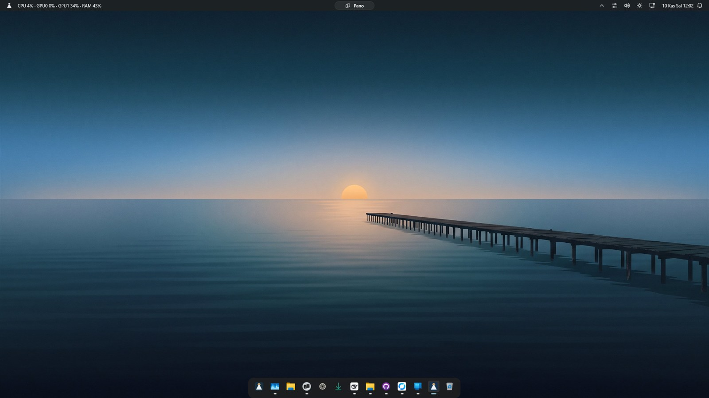
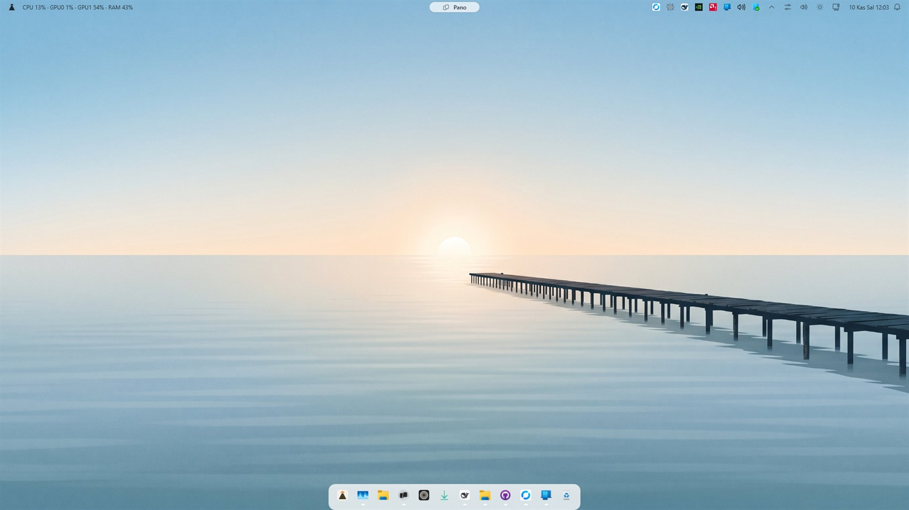
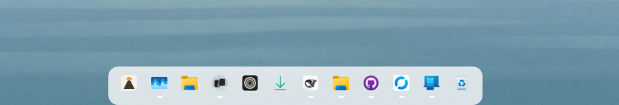
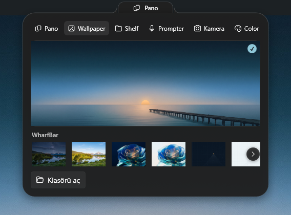
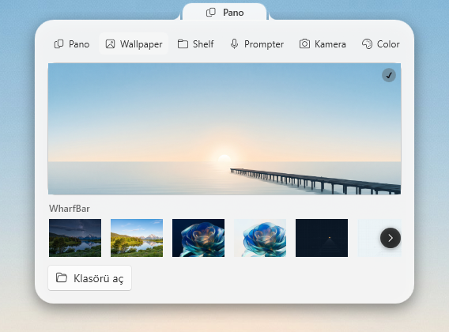
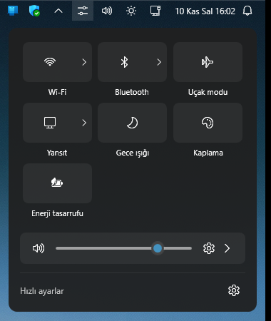
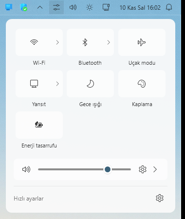
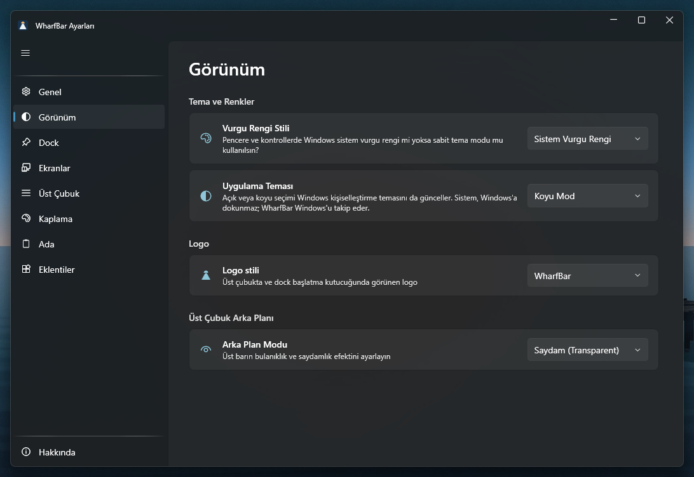
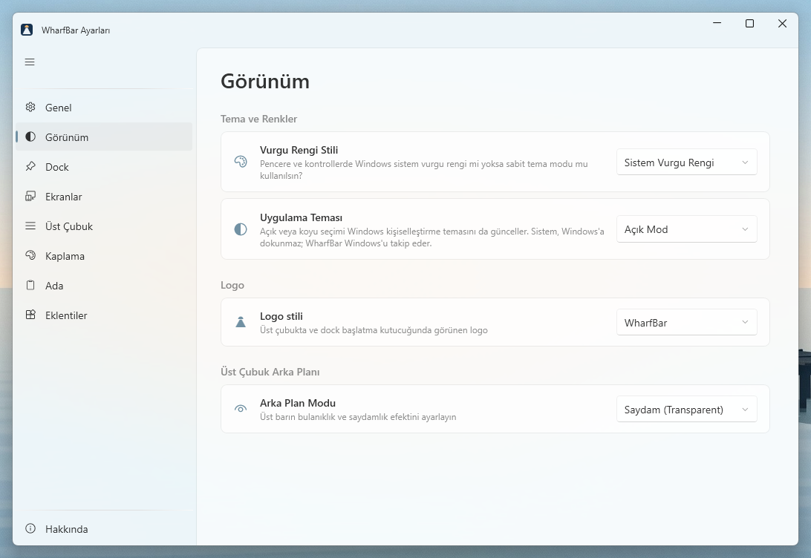

<p align="center">
  
</p>

<h1 align="center">WharfBar</h1>

<p align="center">
  Windows için Fluent üst çubuk ve dock — gerçek AppBar alanı, sabitlenmiş ve çalışan uygulamalar, sakin bir durum şeridi.
</p>

<p align="center">
  
  
  
  
  
</p>

<p align="center">
  <a href="README.md">English</a>
  ·
  <a href="https://github.com/xkeidm/wharfbar/milestones">Yol haritası</a>
  ·
  <a href="CHANGELOG.md">Changelog</a>
</p>

---

## Nedir

WharfBar, Windows masaüstüne kendi üst çubuğunu ve dock’unu çizer — Windows, macOS ve Linux kabuklarından esinlenir; görünüm Windows Fluent’tir (Apple markası veya ikon dili yok). Uygulama işareti **Dusk** iskele + güneştir; Ayarlar → Görünüm’den çubuk/dock glifi Windows logosuna alınabilir.

Üst çubuk gerçek bir AppBar’dır (`ABE_TOP`, 30 DIP): büyütülmüş pencereler onun altında kalır. Dock her zaman üstte duran bir örtüdür. WharfBar açıkken Windows görev çubuğu gizlenir; normal çıkışta önceki haline döner.

Her uygulama kendi menüsünü taşır. Üst çubukta saat, durum, tepsi ve kontroller vardır. Seçim çakışırsa sıra: düşük kaynak kullanımı, sonra Fluent görünüm, sonra basitlik.

## İndirme ve kurulum

En son beta: [GitHub Releases](https://github.com/xkeidm/wharfbar/releases) — tüm `1.0.0-beta*` sürümleri ön sürüm (prerelease) olarak yayınlandığı için beta süresince `/releases/latest` bağlantısı bir sürüme çözülmez.

| Dosya | Ne için |
|-------|---------|
| `WharfBar-Setup-<sürüm>-x64.exe` | Kurulum: kullanıcı bazlı kurar (yönetici / UAC istemez), Başlat menüsüne kısayol ekler ve Ayarlar → Uygulamalar listesine girer. |
| `WharfBar-<sürüm>-win-x64-portable.zip` | Kurulumsuz: bir klasöre açıp `WharfBar.exe` çalıştırılır; kurulum kaydı ve kaldırma girdisi oluşmaz. |

WharfBar kendi .NET çalışma zamanını taşır (self-contained): ayrıca .NET kurmak gerekmez. Kurulum varsayılan olarak `%LOCALAPPDATA%\Programs\WharfBar` altına yapılır; ayarlar `%APPDATA%\WharfBar\config.json` içinde kalır ve güncelleme ile kaldırmadan sonra korunur. Otomatik başlatma uygulamanın kendi ayarıdır (Ayarlar → Genel → Windows ile başlat); kurulum ayrıca bir başlangıç girdisi oluşturmaz.

> **Not (beta).** Kurulum dosyası kod imzalı değil; Windows SmartScreen "Windows kişisel bilgisayarınızı korudu" uyarısı verebilir (Daha fazla bilgi → Yine de çalıştır). `1.0.0-beta*` sürümleri GitHub'da ön sürüm (prerelease) olarak yayınlanır.

Ayrıntı, doğrulama ve sürüm çıkarma adımları: [docs/07-packaging-and-releases.md](docs/07-packaging-and-releases.md).

## Ekran görüntüleri

Windows 11'de, WharfBar'ın kendi **Pier Horizon** duvar kâğıdı çifti üzerinde gerçek ekran görüntüleri. Her çiftte soldaki **koyu**, sağdaki **açık** temadır — büyütmek için görsele tıklayın.

<p align="center">
  <a href="docs/media/screens/tr/hero-dark.jpg"></a>
  <a href="docs/media/screens/tr/hero-light.jpg"></a>
</p>
<p align="center"><sub><b>Masaüstü</b> — duvar kâğıdının üzerinde saydam üst çubuk, ortadaki ada ve dock.</sub></p>

<p align="center">
  <a href="docs/media/screens/tr/dock-dark.png"></a>
  <a href="docs/media/screens/tr/dock-light.png"></a>
</p>
<p align="center"><sub><b>Dock</b> — görev çubuğu pinleri, çalışan uygulamalar ve başlatma karosu tek plakada.</sub></p>

<p align="center">
  <a href="docs/media/screens/tr/island-dark.png"></a>
  <a href="docs/media/screens/tr/island-light.png"></a>
</p>
<p align="center"><sub><b>Ada</b> — hapın altında duvar kâğıdı galerisi.</sub></p>

<p align="center">
  <a href="docs/media/screens/tr/quick-settings-dark.png"></a>
  <a href="docs/media/screens/tr/quick-settings-light.png"></a>
</p>
<p align="center"><sub><b>Hızlı ayarlar</b> — Wi-Fi, Bluetooth, yansıtma, gece ışığı, kaplama ve ses.</sub></p>

<p align="center">
  <a href="docs/media/screens/tr/settings-dark.png"></a>
  <a href="docs/media/screens/tr/settings-light.png"></a>
</p>
<p align="center"><sub><b>Ayarlar</b> — Görünüm; açık/koyu uygulama teması dahil.</sub></p>

## Neden çalıştırılır

- Saat, CPU / GPU / RAM, ağ, pil, bildirimler ve hızlı ayarlar tek ayrılmış şeritte
- Kapalı olanlar dahil sabitlenmiş uygulamalar ve çalışan uygulamalar aynı dock’ta — uygulama başına bir kutu; görev çubuğu o sırada görünmez
- Pano geçmişi, şimdi çalan ve kısa ses / parlaklık / pil okumaları ortadaki adada
- Wi-Fi, ekran yansıtma, monitör parlaklığı ve medya kontrolleri çubuktan
- Seyrek boşta iş: paylaşılan pencere sayımı (~3 sn), istatistikler 4 sn’de bir UI dışı, tepsi aynası 4 sn’de bir (her turda bitmap yeniden çekilmez)

## Özellikler

<details>
<summary><strong>Üst çubuk</strong></summary>

<br>

Açık olan her monitörün kendi çubuğu vardır ve her çubuk kendi monitöründe AppBar olarak kaydolur. Görünürlük `monitors` ayarındadır.

- **Sol:** marka logosu menüsü (sol veya sağ tık; varsayılan WharfBar Dusk işareti; `logoStyle` ile isteğe bağlı Windows logosu) — Windows Ayarları, profil, kilitle, uyku, kapat, yeniden başlat, WharfBar ayarları, Hakkında ve çıkış — ve tek satır `CPU · GPU · RAM`. Üzerine gelince kıvılcım ve ağ hızı açılır. Birden fazla GPU ayrı yazılabilir (`topBar.showGpuPerAdapter`). GPU sayacı yoksa o bölüm görünmez. Sıcaklık yoktur.
- **Orta:** ada hapı.
- **Sağ:** sağ tık menüsünden veya Ayarlar → Üst Çubuk’tan gösterilip gizlenen ve sıralanan durum şeridi. Varsayılan sıra: tepsi aynası, gizli simgeler oku, saat, bildirimler, hızlı ayarlar, ağ, pil. Ses, parlaklık ve medya katalogdadır ve başta kapalıdır; ada bunları zaten gösterir. Kayıtlı sıra korunur.
- Saat, seçilen arayüz diline göre tek satır biçimlenir (Ayarlar → Genel → Dil; Sistem seçiliyse Windows arayüz dili). Tıklanınca bildirim metni ve aylık takvim açılır. Zil `Win+N` gönderir.
- Arka plan Mica, saydam veya renkli olabilir; renkli modda opaklık kaydırıcısı vardır. Mica ile `AllowsTransparency` birlikte kullanılmaz.

</details>

<details>
<summary><strong>Ada</strong></summary>

<br>

Birincil çubukta hap boşta **Pano** yazar. `island.idleLabel` değeri `lastClip` ise son kaydı gösterir. Şimdi çalan parçada genişler (`island.musicPresence` varsayılanı `persistent`, diğer seçenek `transient`). Ses, parlaklık ve pil için kısa süre sayaç olur. Bir HUD yüzünde yanında en fazla iki uydu durabilir; şimdi çalan hapı yalnızca kapak ve parça adıdır. Panel çalan parçanın kapağından renklenir; müzik gövdesindeki ilerleme ve süre canlı güncellenir. Pano geçmişi ve dosya bırakma birincil hapa aittir. İkincil monitörün hapı yalnızca müziği ve bu sayaçları gösterir. Çubuk 30 DIP kalır; panel hapın altında açılır.

Düşük pil eşiği `island.lowBatteryPercent` (varsayılan 20, kabul edilen aralık 5–50).

</details>

<details>
<summary><strong>Dock</strong></summary>

<br>

Her zaman üstte duran bir örtü: alt-sol, alt-orta, alt-sağ veya sol kenar. Otomatik gizlenebilir; başka bir uygulama tam ekranken gizlenir.

- **Sol:** Windows görev çubuğunun `User Pinned\TaskBar` kısayolları, görev çubuğu sırasında, çalışmayanlar dahil. Ardından `dock.items` içinde olup orada olmayanlar. Çalışan bir pin aynı kutuda kalır.
- **Sağ:** sabitlenmemiş çalışan uygulamalar. Uygulama başına bir kutu (kanonik yol, AppUserModelID veya süreç kimliği). Fazla pencereler sayı rozeti ve **Pencereler** alt menüsüdür. Küçültülmüş pencere ikinci kutu olmaz.
- Simge sabit boydadır. Varsayılan glif 24 DIP, düğme 40, aralık 4 DIP. Üzerine gelince düğmenin içi dolar; bu monitördeki pencerelerin DWM küçük resmi açılabilir. UI Automation ilerleme bildirdiğinde ikonun altında çubuk belirir. Dikkat isteyen simge kısa bir vurgu nabzı alır.
- Sabitle ve kaldır `dock.items` yazar. Hedef dosya veya klasörse `User Pinned\TaskBar` içine `.lnk` de yazılır. `Taskband`’a dokunulmaz.
- Sürükleyerek sıralanır. Explorer’dan `.lnk`, `.exe`, `.bat` veya `.cmd` bırakılır. Sağ tık: başlık kartı, sabitle veya kaldır, görevi sonlandır, pencereyi kapat, yönetici olarak çalıştır, dosya konumunu aç, yeni pencere, pencere listesi.
- Arka plan Mica, saydam veya renkli olabilir ve üst çubuktan bağımsız seçilir.
- **Launchpad** (en solda), **Görev Görünümü** (hemen ardından), **İndirilenler** ve **Geri Dönüşüm Kutusu** (en sağda) yerleşik karolardır; pin klasörüne yazılmaz. Görev Görünümü, Windows Görev Görünümü’nü açar/kapatır (`Win+Tab`). Klasör pini yığın açar. Store paketinin simgesi çözülürse o simge, çözülmezse harf kullanılır. Rozet, çalışan işareti ve küçük resim yalnızca o dock’un monitöründeki pencereleri sayar.

</details>

<details>
<summary><strong>Görev çubuğu</strong></summary>

<br>

WharfBar çalışırken Windows görev çubuğu gizlidir. Normal çıkış, açılıştan önceki durumu geri yükler. Süreç zorla öldürülürse bir watchdog görev çubuğunu yaklaşık yarım saniyede geri getirir. Üstte ayrılan şerit ayrı bir konudur; [Derleme ve çalıştırma](#derleme-ve-çalıştırma) altındaki uyarıya bakın.

</details>

<details>
<summary><strong>Hızlı ayarlar</strong></summary>

<br>

Hızlı ayarlar, ses veya ağ simgesinden açılan tek flyout: **Main**, **Mixer** ve **Network**.

- Wi-Fi: `wlanapi` ile canlı ağ listesi, bağlanma ve kopma. Profiller düz metin olarak kaydedilir. Radyo kapalıyken liste boştur. Gizli ve kurumsal ağlar Windows Ayarları’na bırakılır.
- Bluetooth: radyo ve eşleşmiş klasik ile LE cihazlar. Cihaza bağlanmak Windows Ayarları’ndadır.
- Gece ışığı, ayar yazılabiliyorsa gerçek durumu izler. Yazılamıyorsa karo Windows Ayarları’nı açar.
- Yansıt: yalnızca PC ekranı, çoğalt, genişlet veya yalnızca ikinci ekran.
- Enerji tasarrufu karosu sistem anahtarını izler ve onu çevirir.
- Kaplama karosu renk örtüsünü açıp kapatır.

</details>

<details>
<summary><strong>Parlaklık · Medya · Kaplama</strong></summary>

<br>

**Parlaklık** — ayrı bir flyout: bütün ekranlar için bir ana kaydırıcı ve monitör başına bir kart. Masaüstü monitörler DDC/CI, dahili paneller WMI kullanır. Yazma, 50 ms gecikmeli bir arka plan kuyruğundan geçer.

**Medya** — Windows SMTC. Durum şeridindeki medya simgesi yalnızca bir oturum varken görünür. Flyout kapak, başlık, sanatçı, oynat/duraklat, önceki ve sonraki düğmelerini gösterir. Birden fazla uygulama aktifse oturum seçici çıkar. Ada, şimdi çalanı hapta tutabilir.

**Kaplama** — birincil monitörde tıklamayı geçiren tam ekran renk örtüsü. Hızlı ayarlardan veya kısayolla açılır (varsayılan `Ctrl+F11`). Renk, opaklık ve kısayol Kaplama ayar sayfasındadır.

</details>

<details>
<summary><strong>Tepsi</strong></summary>

<br>

WharfBar’ın kendi bildirim simgesinde çıkış maddesi **WharfBar'ı kapat** vardır. Birincil çubukta üçüncü taraf tepsi ikonları belgelenmiş araç çubuğu mesajlarıyla okunur ve tıklama iletilir. Seçilen simgeler okun arkasındaki bir hapta durabilir; ok, Windows’un gizli simgelerini de `Win+B` ile açar. Sistem simgeleri elenir. Windows’un taşma alanında tuttuğu simgeler orada kalır. Bu araç çubuğunun kalktığı Windows 11 25H2 ve sonrasında ayna UI Automation kullanır. İkincil çubukta yalnız ok vardır. İkonlar başka sürecin belleğinden okunmaz.

</details>

<details>
<summary><strong>Launchpad ve eklentiler</strong></summary>

<br>

Launchpad karosu duvar kâğıdının üstünde, ortada tek bir yüzey açar. Yalnız **Windows tuşuna** basmak da açar (kapatmak için tekrar basın; `Win+<tuş>` kısayolları çalışmaya devam eder). Uygulama taraması bitmeden açılabilir. Uygulamalar harf başlıklarının altında gruplanır. Üst çubuk logosu Launchpad’i değil, logo menüsünü açar. Telefon sütunu yalnız bir telefon bağlıyken görünür. Ad, pil ve bildirim sayısı Your Phone başlangıç kartından gelir; ekran görüntüsü telefon çerçevesinin içindedir. Eksik alan gizlenir.

Widget ve Eklenti, Ayarlar → Eklentiler ile aynı kataloğu açar. Çalışan parçalar Bluetooth bağlantı bildirimi ve kamera aynasıdır. `%AppData%/WharfBar/plugins/<klasör>/manifest.json` bir aç/kapa kaydıdır. Eklenti derlemeleri yüklenmez. Üst çubuk ve dock yuvaları kaydedilir, çizilmez.

</details>

<details>
<summary><strong>Yapılandırma, başlangıç, tek örnek, DPI</strong></summary>

<br>

- Yapılandırma `%AppData%/WharfBar/config.json` dosyasındadır (`schemaVersion`). Ayar sayfaları: Genel, Görünüm, Dock, Ekranlar, Üst Çubuk, Kaplama, Ada, Eklentiler, Hakkında. Değişiklikler hemen uygulanır.
- Otomatik başlatma, Startup klasöründeki `WharfBar.lnk` kısayoludur (`AppConfig.autostart`). Registry Run anahtarı kullanılmaz.
- Adlandırılmış bir mutex ikinci örneğin çıkmasını sağlar.
- DPI farkındalığı Per-Monitor V2’dir (`app.manifest`).

</details>

## Gereksinimler

- Windows 10 sürüm 19041 (2004) veya üstü / Windows 11, **x64**
- Kurulum dosyası veya portable zip için ek gereksinim yok — uygulama .NET 8’i kendi içinde taşır
- Kaynaktan derlemek için .NET SDK 8 veya 9 (SDK 9, `net8.0` hedefini derleyebilir)
- `global.json` bilinçli olarak yok — SDK’yı 8.x’e sabitlemek, yalnız .NET 9 SDK olan makinelerde derlemeyi kırar

## Derleme ve çalıştırma

```bash
git clone https://github.com/xkeidm/wharfbar.git
cd wharfbar

dotnet build WharfBar.sln
dotnet run --project src/WharfBar
```

Depo kökündeki `run.bat` dosyasına da çift tıklanabilir. Derler, ardından `WharfBar.exe`’yi ayrı süreç olarak başlatır; o konsolu kapatmak uygulamayı öldürmez.

> **Uyarı.** Uygulama açıkken ekranın üstünde bir şerit ayırır ve Windows görev çubuğunu gizler. Zorla sonlandırma (`Stop-Process -Force`, hata ayıklayıcıyı koparma, ham `dotnet run` konsolunu kapatma) `ABM_REMOVE` yolunu atlar. Görev çubuğu watchdog’u çubuğu yaklaşık 0,5 saniyede geri getirir. Ayrılan şerit, `explorer.exe` yeniden başlatılana kadar asılı kalabilir. Normal çıkış (tepsi **WharfBar'ı kapat** veya Alt+F4) ikisini de geri yükler. `dotnet run` penceresini kapatmak yerine `run.bat` kullanın.

İkinci örnek, adlandırılmış mutex yüzünden çıkar. `dotnet test`, `tests/WharfBar.Tests` projesini çalıştırır (xUnit).

Sürüm paketlerini (kurulum exe’si, portable zip ve `SHA256SUMS.txt`) yerelde üretmek için Inno Setup 6.3 veya üstü gerekir:

```powershell
pwsh installer/build-release.ps1 -Version 1.0.0-beta.2
```

Çıktı `artifacts/release/` altına yazılır (git’te izlenmez). `v<sürüm>` etiketi itildiğinde aynı betik `.github/workflows/release.yml` içinde çalışır ve dosyaları GitHub Releases’a yükler; ayrıntı [docs/07-packaging-and-releases.md](docs/07-packaging-and-releases.md).

## Nasıl kapatılır

WharfBar bildirim simgesine tıklayıp **WharfBar'ı kapat** seçin veya çubuğa odaklanıp **Alt+F4** tuşlayın. Üst çubuk logo menüsünde de aynı çıkış maddesi vardır.

Betikler, kurulum ve kaldırma çalışan örneği `WharfBar.exe --quit` ile kapatır: görev çubuğu geri yüklenir ve AppBar’lar kaldırılır, yani normal çıkış yolu izlenir. Yükleme sırasında süreci zorla sonlandırmayın; zorla kapatma, ayrılmış üst şeridi `explorer.exe` yeniden başlayana kadar ekranda bırakır.

Bu süreçte `Process.MainWindowHandle` `0` döner (`ShowInTaskbar=false` pencereye gizli bir sahip verir), bu yüzden bir betikten `CloseMainWindow` işe yaramaz. Pencereyi PID ile bulup `WM_CLOSE` gönderin; süreç kapanmaz (üst çubuğu kapatmak çıkış yolu değildir).

## Proje yerleşimi

```
WharfBar.sln
src/WharfBar/
  Views/          TopBarWindow, DockWindow, SettingsWindow, flyout'lar
  Views/Pages/    General, Appearance, Dock, Displays, TopBar, Veil, Island, Plugins, About
  Native/         AppBar, Dwm, ShellIcon, tepsi, DDC/CI
  Models/         AppConfig ve ilgili kayıtlar
  Services/       config, dock, durum, tepsi, ada, hızlı ayarlar
  app.manifest    Per-Monitor V2 DPI
tests/WharfBar.Tests/
docs/
installer/        Inno Setup betiği + yerel sürüm derlemesi
.github/          Issue şablonları ve Release iş akışı
```

Kod kökü `src/WharfBar/`. Arayüz `Views/` altındadır; klasör adı Win32 ile karışmasın diye bu ad kullanılır.

## Dokümanlar

| Doküman | Konu |
|---------|------|
| [docs/00-overview.md](docs/00-overview.md) | Amaç, hedefler ve kapsam |
| [docs/01-architecture.md](docs/01-architecture.md) | Klasörler, servisler ve config |
| [docs/04-gotchas.md](docs/04-gotchas.md) | AppBar, Mica ve DPI tuzakları |
| [docs/07-packaging-and-releases.md](docs/07-packaging-and-releases.md) | Kurulum, portable paket ve sürüm yayını |
| [AGENTS.md](AGENTS.md) | Derleme komutları ve ajan dizini |
| [CHANGELOG.md](CHANGELOG.md) | Sürüm notları (Keep a Changelog; İngilizce) |
| [SECURITY.md](SECURITY.md) | Güvenlik açığı bildirimi (İngilizce) |

## Katkı

Katkı rehberi ve davranış kuralları İngilizcedir: [CONTRIBUTING.md](CONTRIBUTING.md), [CODE_OF_CONDUCT.md](CODE_OF_CONDUCT.md).
Hata ve özellik istekleri GitHub issue şablonlarını kullanır.
Sürümleme kuralları CONTRIBUTING’dedir; güvenlik bildirimleri [SECURITY.md](SECURITY.md) üzerindendir.

## Durum

**Beta (`1.0.0-beta`).** Ayrıntılar [CHANGELOG.md](CHANGELOG.md) dosyasındadır. Genel yol haritası [GitHub Milestones](https://github.com/xkeidm/wharfbar/milestones) üzerindedir: canlı iş Beta polish / Post-beta / Stable 1.0; geçmiş Shipped through 1.0.0-beta; bilerek ertelenenler Deferred / out of scope.

## Lisans

[MIT](LICENSE). [WPF-UI](https://github.com/lepoco/wpfui) de MIT’tir.
